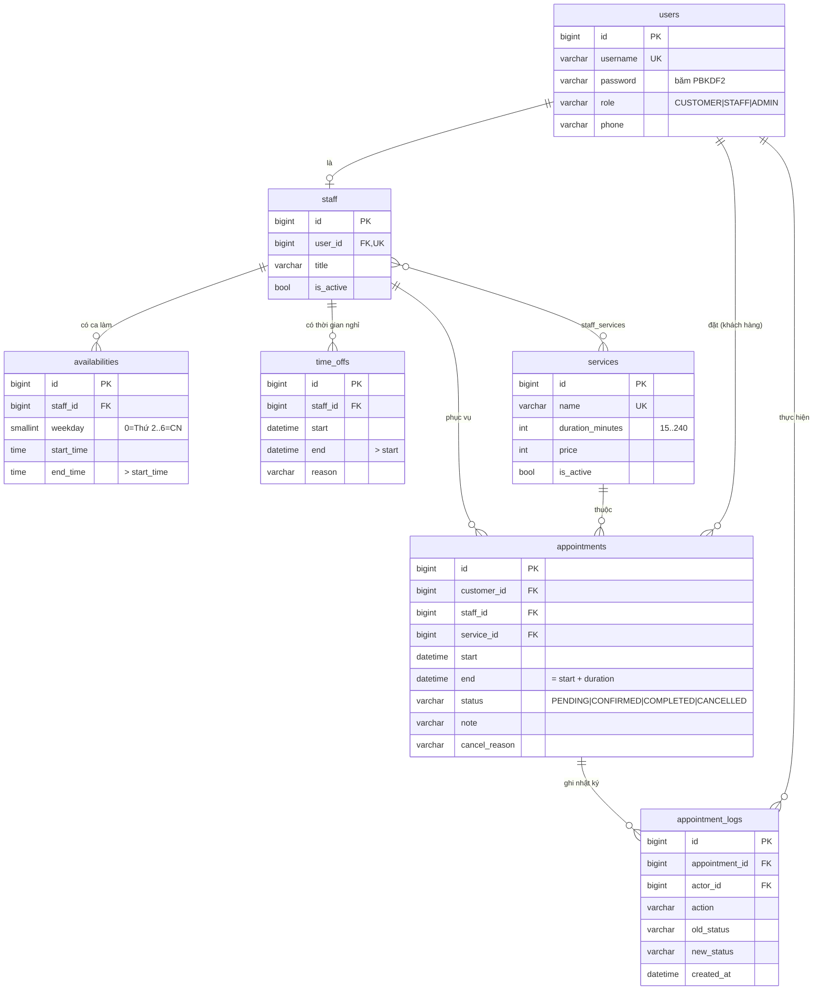

# Sơ đồ ERD

## Quy tắc chống trùng lịch
Hai lịch hẹn A, B **đang hiệu lực** (PENDING/CONFIRMED) của cùng một nhân viên bị coi là chồng lấn khi
`A.start < B.end AND B.start < A.end`. Lịch nối tiếp (A.end = B.start) hợp lệ.

Khi đặt/đổi lịch, máy chủ mở giao dịch, khóa dòng nhân viên (`SELECT ... FOR UPDATE`), kiểm tra lại
giờ làm việc – thời gian nghỉ – chồng lấn, rồi mới lưu. Hai yêu cầu đồng thời vào cùng một thợ phải xếp hàng,
yêu cầu đến sau sẽ thấy lịch vừa được lưu và bị từ chối. Đổi lịch lỗi thì giao dịch không lưu gì, lịch cũ giữ nguyên.
